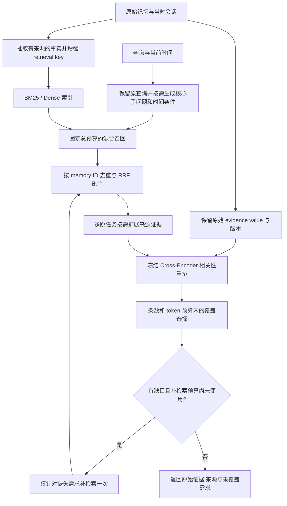

# Memoria：时间约束下的证据覆盖感知检索方案

日期：2026-10-09。状态：方案设计，未实现或获得新的效果数字。约束：不新增模型参数训练；使用冻结 LLM、embedding 和预训练 reranker。工程参数在开发集确定，测试集不参与规则、prompt 或索引设计。

## 方案摘要

面向短记忆语义欠表达、历史事实被年龄过滤以及复杂查询证据不完整的问题，构建“事实增强索引 → 核心需求分解 → 时间条件混合召回 → 来源证据扩展 → 相关性重排 → 预算内覆盖选择”的检索链路。

简单事实查询保留直接召回与重排路径；复杂、多跳或有歧义的查询按需启用扩展、验证和最多一次补检索。最终结果返回原始记忆及来源，派生事实只辅助检索。效果通过逐模块消融、独立测试集和质量/成本对照验证。

“无需训练”指不为该方案新增参数更新：底层模型已有预训练，reranker 使用现成 checkpoint；提示、权重和预算仍需在开发集上验证。本方案是已有论文机制的工程组合，不主张提出新的已验证算法。

## 总体流程

复杂查询的核心子问题与歧义查询的不同解释分别管理；前者需要共同覆盖，后者需要避免将不同解释的事实混在一起。图扩展和 LLM 覆盖验证属于可选模块。

## 为什么调整之前的 pipeline

原方案为“原文/上下文双视图 → BM25/dense → RRF → Cross-Encoder → Top-K”。它针对语义表达和单条相关性，但存在三个不足：

1. 独立检索视图不是必然优于事实增强的单一索引 key。LongMemEval §5.3、§E.3 的实验中，原文拼接抽取事实的 key merging 优于独立视图的 rank merging。该发现限定于其数据集、检索器与设置，不能证明 Memoria 上也必然成立，但值得改变默认实验优先级。[官方发表](https://openreview.net/forum?id=pZiyCaVuti)；[全文](https://arxiv.org/html/2410.10813v2)。
2. 原查询的相似度排序不保证多部分问题的完整证据覆盖。仅召回语义相似的记录可能漏掉身份、原因、旧状态等桥接证据。
3. 独立 query–memory Cross-Encoder 打分不直接优化最终证据集合，多个高分候选可能重复回答同一部分。

因此建议把目标从“每条记忆相关”扩展到“返回的记忆集合覆盖核心证据需求”，同时保留简单查询的低成本路径。

## 拟议 pipeline

### 写入：Fact-Augmented Key / Raw Evidence Value

每条记忆保留原始 value 和来源 ID。由写入当时可见会话抽取独立事实，保留主体、时间、否定、条件与角色归属，构造 `retrieval_key = raw_content + supported_facts`，用于 dense/BM25 索引。可从来源会话补上下文，不允许加入未来消息或测试答案。

优先对照 raw-only 和 fact-augmented key；双视图独立索引作为第三个对照，不预设它更好。BM25 可分字段控制派生内容权重，防止实体重复堆叠。抽取失败回退原文。fact 仍是可能出错的派生数据，不替代原始 value。

依据：LongMemEval §5.3、§E.3；[A-MEM（NeurIPS 2025）](https://proceedings.neurips.cc/paper_files/paper/2025/hash/19909c36f51abc4856b4560aff3d36d6-Abstract-Conference.html)的 contextual descriptions 与关联索引。这里采用 fact-augmented key，不是完整复现 A-MEM。

### 查询：保留原问题，生成有限核心子查询

复杂查询最多生成少量直接回答原问题所必需的 core sub-questions，保留原查询路径。不能为普通问题强制产生背景或衍生追问，也不能预填个人事实答案。

例如“我换到新团队后为什么放弃方案 A”：

- 定位换团队事件及前后时间。
- 查找方案 A 的放弃决定与明确原因。

此时第一部分用来定位证据范围，而不是推定换团队造成放弃。人物、项目、时间条件继承到子查询，避免分解后语义漂移。

依据：[Do RAG Systems Cover What Matters? Evaluating and Optimizing Responses with Sub-Question Coverage（NAACL 2025 主会）](https://aclanthology.org/2025.naacl-long.301/)§5 的 Retrieval Augmentation：原 query 和 core 子问题分别召回、候选合并、按 core 覆盖重排。论文没有明确将这一过程实现为 RRF 或 Cross-Encoder；我们的具体组合是工程适配。论文主要研究开放式问题，其结论不直接证明事实型个人记忆问答收益。

查询时间单独解析，区分 event time、消息记录时间和入库时间。可确定范围时新增时间约束检索；不确定或事件时间缺失时保留宽范围路径，不用猜测的时间切掉全部候选。权限、用户与删除状态属于硬约束，不能在回退时放宽。

依据：LongMemEval §5.4、§E.4 的 time-aware query expansion。子问题机制与新论文核查见 [独立研究记录](/Users/muuushroom/gitrepos/memoria/docs/memoria-query-coverage-literature.md)。

### 召回：预算化混合检索与可观测候选并集

原查询与子查询分别执行 sparse/dense 检索，候选窗口大于最终 K。按 canonical memory ID 去重，用 RRF 融合稀疏和稠密排名。

子查询有固定总预算，避免“多生成几个 query”造成更多投票和更大候选池的混杂收益。各子问题保留候选，跨子问题的最终选择留给证据覆盖阶段。为每条候选记录 query、检索渠道、rank、时间过滤与来源。

当前 [hybrid](/Users/muuushroom/gitrepos/memoria/memoria/crates/memoria-storage/src/store.rs:6274)在内部截到 K，[graph 路由](/Users/muuushroom/gitrepos/memoria/memoria/crates/memoria-service/src/service.rs:1931)在满 K 后提前返回；方案需要候选 API 与最终输出 API 分离。取消早退与换融合公式应分别消融。

### 多跳扩展：从 seed memory 找带来源的补充证据

对多跳查询，从相关 seed memories 沿实体/事实关系扩展来源 memory。第一版可限制一跳和固定候选量；只有来源会话可访问时，才补取关联上下文。

依据：[KG²RAG（NAACL 2025 主会）](https://aclanthology.org/2025.naacl-long.449/)先语义召回、再图扩展 chunks，最后组织证据；[全文 §2.2–2.3](https://arxiv.org/html/2502.06864v1)。论文包含 BFS、多跳扩展、maximum spanning tree 筛选与组级 Cross-Encoder 排序。本方案先借鉴“扩展回原文”，不直接复制 MST，因为记忆中的时间、修正和条件信息未必适合被树结构裁剪。

当前 backfill 的 memory/entity links 不等于带来源的事实关系图；必须先检查关系边覆盖与实体消歧。相同实体不自动证明两条记忆相关，更不证明因果。扩展后继承权限、主体与时间语义并进入重排。图质量不足时跳过该模块。

### 选择：相关性重排 + 核心证据覆盖

预训练 Cross-Encoder 对原问题/核心子问题和原始 value 打分，派生事实只能辅助定位。保留足够原文窗口，不能仅凭生成的索引描述判定答案受支持。

随后按证据集合而非单条排序进行选择：优先新增尚未被覆盖的子问题证据，在固定条数/上下文预算下抑制近重复候选。简单单事实问题直接按相关性排序，不强制追求 diversity。

一个用于实验的工程目标是：

\[
\max_{S\subseteq C}\;\sum_j w_j\max_{m\in S}a(m,q_j)
+\lambda\sum_{m\in S}r(m,q)-\mu\,\mathrm{Redundancy}(S),
\quad |S|\le K,\quad \mathrm{Tokens}(S)\le B.
\]

`a` 是对核心子问题的支持程度，`r` 是原查询相关性。权重和预算来自开发集，不进行学习。这是本方案的启发式集合选择目标，不是引用论文的原算法，也没有最优性或收益保证。

第一版可用逐子问题覆盖与来源去重的贪心选择；复杂任务再尝试让冻结 LLM 输出“受支持/部分支持/未支持”及对应原文 span。Cross-Encoder 分数不能当作已校准的支持概率，LLM 的覆盖判断也可能错，不能宣称确保事实完备。

### 回退：仅补检索缺失的需求，最多一轮

如果核心子问题仍无支持证据，只对缺失部分再检索一次。无法补足时返回可用证据和明确缺口，不将推测写入永久记忆。最大轮数、候选量及调用次数作为硬预算；超过预算或模块失败回退基线。

依据：[DIVA（NAACL 2025 主会）](https://aclanthology.org/2025.naacl-long.56/)对歧义问题的每个解释做上下文支持验证，分 Useful、PartialUseful 和 Useless。它验证的是多种解释，不是复杂问题的核心子需求，两者要分别触发，不能混成同一类子查询。原方法的 PartialUseful 不自动补检索，Useless 回退 closed-book；本方案借鉴验证机制，但把回退改成有预算的补检索/澄清/证据不足，私人事实不能靠 LLM 内部知识恢复。

这是工程自适应策略，需分别评估其额外成本与补回的证据。不要用固定 reranker 阈值声称具备通用“置信度”。歧义问题需要保持不同解释的证据隔离；其他人的同名实体不能成为个人事实。DIVA 使用逐解释 LLM 验证，成本高于 vanilla RAG，因此仅对歧义查询启用，不能宣称整个 pipeline 更低成本。

## 范围与评测

第一阶段只实现事实增强 key、候选窗口分离、冻结 reranker 与保守时间路径。第二阶段增加 core sub-queries 和覆盖感知选择；第三阶段才加入可靠图扩展与一次补检索。不同时堆叠 PPR、命题 beam search、HyDE、深层摘要树和句子裁剪。

评测对照：原实现 → 候选并集 → key expansion → reranker → core subqueries → coverage selection → graph expansion → bounded retry。每次只改变一个模块，保持模型、语料快照、总检索预算及上下文预算一致；另报告允许额外预算时的质量/成本曲线。

报告：候选 Recall、最终 Recall@K/MRR、全部必需证据入选率、历史状态正确率、来源支持率、每事件重复占比、补检索触发率及成功率、p95 延迟与 token 成本。答案质量另由 Reader/Judge 验证，不能从召回指标推定。

注意 Memoria 的年龄置信度过滤可能先排除历史证据：相关性、事实是否错误、是否当前有效与是否能回答过去问题需要分开。保留独立用户/会话测试和时间外推测试，构建索引不使用未来消息。

## 建议的数据契约

以下为逻辑字段建议，实际可通过附属表或派生索引实现，不代表需要立即修改核心 Memory schema。

| 对象 | 关键字段 | 用途 |
|---|---|---|
| 索引视图 | `memory_id`、`source_version`、`retrieval_key`、`supported_facts`、`extractor_version` | 保留原文与派生索引映射，支持回填、重建及追踪 |
| 事实来源 | `source_memory_ids`、原文 span、主体、事件时间及限定条件 | 检查事实是否有支撑，区分事件时间与记录时间 |
| 检索计划 | 原查询、核心子问题或歧义解释、时间条件、各路候选预算、补检索次数 | 固定计划与调用预算，避免无限扩展 |
| 候选轨迹 | `memory_id`、命中查询、检索渠道、原始 rank、融合分、重排分、扩展来源 | 解释证据在哪个阶段进入或退出 |
| 覆盖判断 | 需求 ID、支持状态、来源 ID、支持 span | 分开记录“相关”与“有原文支持” |
| 检索结果 | 原始记忆、来源及版本、未覆盖需求、实际调用/延迟 | 保持对现有返回接口的兼容，并提供 explain 信息 |

修改、纠错、删除或分支切换后，派生 key、图链接和缓存需要失效或更新。发现来源版本不一致时回退 raw-only 检索，不能继续以陈旧派生内容作为证据。回退路径同样遵守用户、主体、权限和删除约束。

## 实施里程碑与验收

| 阶段 | 交付内容 | 验收依据 |
|---|---|---|
| M0：基线与可观测性 | 固定语料和查询集；记录召回、过滤、截断和输出候选；分离候选窗口与 K | 能逐 query 定位漏存、漏召回、过滤与排序损失；路由和融合变化独立对照 |
| M1：表示与排序 | raw-only / fact-augmented 索引开关；预训练 reranker；时间约束与宽范围回退 | 独立比较各模块的 Recall、MRR、历史任务表现及成本；失败时能回退原链路 |
| M2：覆盖选择 | 少量 core 子查询；固定总召回预算；覆盖感知选择 | 同预算下比较最终完整证据覆盖与答案支撑率；报告简单事实查询的退化情况 |
| M3：按需扩展 | 来源关系边检查；有限图扩展；歧义验证；一次定向补检索 | 验证扩展补回的真实证据、跨主体/时间错误、补检索收益与额外延迟 |

上线判断不预填未经验证的提升比例。先在开发集确定预算与可接受退化，再冻结配置到独立测试集验证；同时报告平均收益、分组退化和逐 query 变化。对 LLM 支持判断进行人工抽查，避免用同一个模型自评作为唯一证据。

必须覆盖的边界情况：抽取或模型调用失败、候选为空、时间信息缺失、同名不同主体、旧事实与新事实冲突、来源被删除或修正、图覆盖不足、重复候选、补检索仍无证据及预算耗尽。

## 论文依据与适配边界

| 来源 | 正式场所 | 采用部分 | 不直接沿用的部分 |
|---|---|---|---|
| [LongMemEval](https://openreview.net/forum?id=pZiyCaVuti) | ICLR 2025 主会 | 事实增强 key、时间感知检索、检索与阅读分开评测 | 不把其数据集结果视为 Memoria 已实现收益 |
| [A-MEM](https://proceedings.neurips.cc/paper_files/paper/2025/hash/19909c36f51abc4856b4560aff3d36d6-Abstract-Conference.html) | NeurIPS 2025 主会 | 上下文描述、可关联的记忆表示 | 不让自动演化覆盖原始事实或丢失版本 |
| [Sub-Question Coverage](https://aclanthology.org/2025.naacl-long.301/) | NAACL 2025 主会 | core 分解、分别召回、按覆盖重排 | 不对简单问题生成大量背景与衍生子问题 |
| [KG²RAG](https://aclanthology.org/2025.naacl-long.449/) | NAACL 2025 主会 | seed-based 关系扩展、回溯原文证据 | 不直接复制 MST 裁剪，也不预设当前图质量足够 |
| [DIVA](https://aclanthology.org/2025.naacl-long.56/) | NAACL 2025 主会 | 歧义解释与逐解释支持验证 | 不用 closed-book 回答无证据的私人事实；补检索是本方案适配 |

年份按正式发表计；LongMemEval 在 2024 年已有预印本。论文核查详见 [2025 年以来研究记录](/Users/muuushroom/gitrepos/memoria/docs/memoria-retrieval-2025-onward.md)与[查询覆盖研究记录](/Users/muuushroom/gitrepos/memoria/docs/memoria-query-coverage-literature.md)。

## 简历方案设计表述

> 设计面向长期交互记忆的时间约束与证据覆盖感知检索框架：采用 Fact-Augmented Key/Raw-Value 解耦索引，结合核心子问题驱动的 Sparse–Dense 召回、RRF 融合与冻结 Cross-Encoder 重排；通过预算化证据集合选择和来源可追溯扩展缓解语义欠表达及多跳证据缺失，并设计模块消融评估质量与延迟。

以上为拟议设计，不能写成已经实现的完整系统。已有 RRF 小样本结果不能作为整条 pipeline 的收益。

## 项目叙事：动机、出发点、尝试方法与实现效果

### 动机

长期交互记忆问答需要识别人物、项目、事件和历史状态，并利用多条证据回答原因或变化过程。短记忆缺少上下文、原查询表达不匹配以及重复候选占据 Top-K，都可能使已保存的事实不能被有效利用。目标是在不新增模型参数训练的条件下，提高证据检索质量，并保留来源可追溯性和推理预算。

### 出发点

分别从记忆表示、候选生成、排序和证据选择归因：上下文缺失用事实增强索引处理；多部分查询用核心需求分解处理；内部截断和 graph 早退用候选并集处理；相关但重复的候选用覆盖感知选择处理；历史问题单独考虑事件时间与旧事实有效性。不能仅凭整体 Recall 变化确定问题所在。

### 尝试方法

已有本地实现是 graph 不足、补充 hybrid 路径的 RRF 融合，尚非完整的新 pipeline。完整方案设计包括事实增强 key/value 解耦、时间条件与核心子查询、Sparse–Dense 候选并集、冻结 Cross-Encoder、覆盖感知选择及按需来源扩展/一次补检索。后续按前述 M0–M3 逐模块实现和消融。

### 已有实验效果

数据来源：[RRF rerun 比较记录](/Users/muuushroom/gitrepos/memoria/benchmarks/fusion/results/lme-rerun-comparison.json)。LongMemEval-S cleaned 自定义子集，30 题、六类各五题，BGE-M3 embedding，检索输出 Top-20。

| 指标 | 基线 | 本地 RRF | 解读 |
|---|---:|---:|---|
| Recall@5 | 73.33% | 76.67% | 约增加 3.33 个百分点 |
| CompleteRecall@5 | 66.67% | 70.00% | gold session 完整覆盖有所增加 |
| Recall@20 | 95.00% | 95.00% | 未增加该窗口的召回覆盖 |
| MRR@20 | 0.673889 | 0.671111 | 略有下降，不能声称排序全面改善 |

该轮 Recall@5 的逐题胜/平/负为 3/26/1。结果只支持小样本上局部 Top-5 session 覆盖改善，不证明最终答案正确率、独立泛化或完整 pipeline 收益。评测未调用 Reader/Judge，图回填为零边，不能验证多跳扩展。单轮记录的 p95 为 685.972 → 630.153 ms，需等价预热和重复测量才能判断稳定性能变化。

事实增强索引、Cross-Encoder、核心子问题与覆盖选择等新模块目前没有独立效果数字，应写作方案设计或待验证项。
